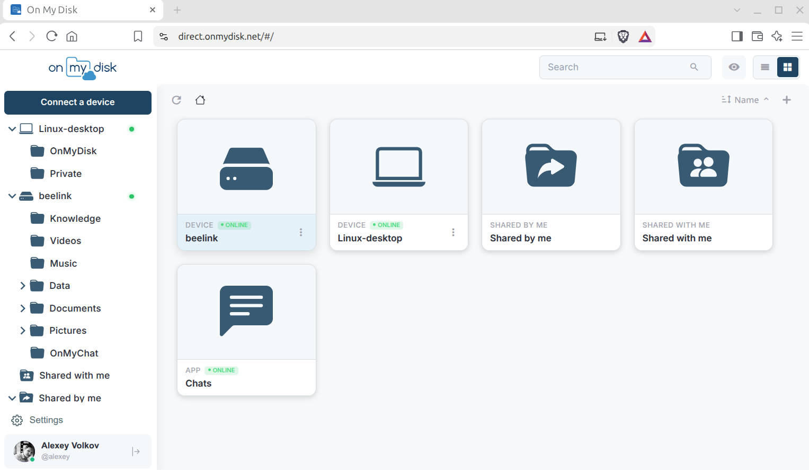

# Direct — Decentralized P2P Cloud & Local AI Platform

> Self-hosted personal cloud and sovereign AI assistant over a direct P2P WebRTC data plane.
> Your files, RAG memory, and local models stay on your hardware — the gateway only coordinates peers.

[](LICENSE)
[](https://disk.direct)
[](https://aiassistant.direct)
[](core/)
[](web/)
[](ai/)



> **⚡ Live Entry Points:**
> - 📂 **Disk Direct:** [**disk.direct**](https://disk.direct) — P2P file manager, WordCraft / GridCraft / DeckCraft office editors, media streaming, and remote WebRTC SSH terminal.
> - 💬 **AI Assistant Direct:** [**aiassistant.direct**](https://aiassistant.direct) (or [**chat.disk.direct**](https://chat.disk.direct)) — private RAG over your folders, autonomous MCP agents, ComfyUI Creative Studio, and AI Horde worker/client.

---

## Architecture

```text
  Browser / Mobile PWA (web/, mobile/)        Storage Node (core/)                    AI Assistant Node (ai/)
  ┌──────────────────────────────┐            ┌──────────────────────────┐  RAG /     ┌──────────────────────────┐
  │ disk.direct                  │ WebRTC     │ files · media · terminal │  MCP tools │ FastAPI · ChromaDB RAG   │
  │ aiassistant.direct           ├──DataCh───►│ P2P Storage Node (C++/Qt)├───────────►│ MCP agent · Face Engine  │
  └────▲──────────▲──────────────┘  (direct)  └──────────▲───────────────┘  localhost └────────────┬─────────────┘
       │          │                                      │  127.0.0.1:4000                         │
       │ DID auth │ WebSocket signaling                  │ TLS control link                        ▼
       │ & sync   │ & ICE negotiation                    │ (LinkMessage)              ┌──────────────────────────┐
       ▼          └───────────────┬──────────────────────┘                            │ Local Compute & Horde    │
  ┌─────────────────────────┐  ┌──┴─────────────────────────┐                         │ • Ollama / RKLLAMA (LLM) │
  │ services/gun-hub        │  │ core/Gateway.pro           │                         │ • ComfyUI (SDXL / Krea2) │
  │ GunDB DID relay, chats, │  │ Signaling coordinator &    │                         │ • AI Horde Dreamer       │
  │ device cert authority   │  │ TURN fallback (coturn)     │                         └──────────────────────────┘
  └─────────────────────────┘  └────────────────────────────┘
```

---

## Monorepo Structure

| Directory | Component | Description |
| :--- | :--- | :--- |
| [`core/`](core/) | **P2P Node & Gateway (C++ / Qt)** | `Node.pro` (Linux, Windows, macOS, OpenWrt storage & SSH daemon), `Gateway.pro` (signaling server), and `OnMyDiskLink/` (WebRTC DataChannel & TLS engine) |
| [`ai/`](ai/) | **AI Assistant Node (Python)** | FastAPI service (`127.0.0.1:4000`), ChromaDB multimodal RAG, InsightFace recognition, MCP tools, ComfyUI Creative Studio, and AI Horde client & Dreamer worker |
| [`web/`](web/) | **Unified Web Client (Svelte 5)** | Single PWA serving both `disk.direct` and `aiassistant.direct` — file manager, office suite, terminal, AI chat, memory cards, and studio |
| [`mobile/`](mobile/) | **Mobile Apps (Capacitor)** | Native iOS and Android wrappers (`direct.disk.app`) |
| [`services/`](services/) | **Coordination Microservices** | `gun-hub/` (GunDB SEA DID relay & device PKI), `coturn/` (TURN server config), and `webpush/` |
| [`docs/`](docs/) | **Documentation** | Technical specifications, screenshots, and the documentation site (`docs/site/`) |

---

## Quick Development Start

### 1. C++ Storage Node & Signaling Gateway (`core/`)
```bash
cd core

# Build Signaling Gateway -> core/run/bin/omd-server
qmake Gateway.pro && make -j$(nproc)

# Build P2P Storage Node -> core/Node/target/usr/bin/onmydisk
qmake Node.pro && make -j$(nproc)
```

### 2. Local AI Assistant Node (`ai/`)
```bash
cd ai
python3 -m venv venv
source venv/bin/activate
pip install -r requirements.txt
cp config.example.ini config.ini
uvicorn api:app --host 127.0.0.1 --port 4000
```

### 3. Web PWA Client (`web/`)
```bash
cd web
npm install --legacy-peer-deps
npm run dev
```

### 4. Self-Hosted Gateway Stack (`docker-compose.yml`)
```bash
docker compose up -d
```

---

## License

Licensed under the [Apache License 2.0](LICENSE).

