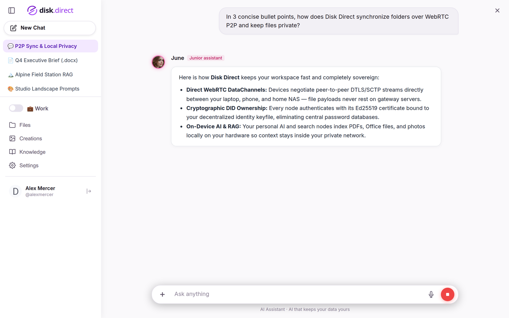
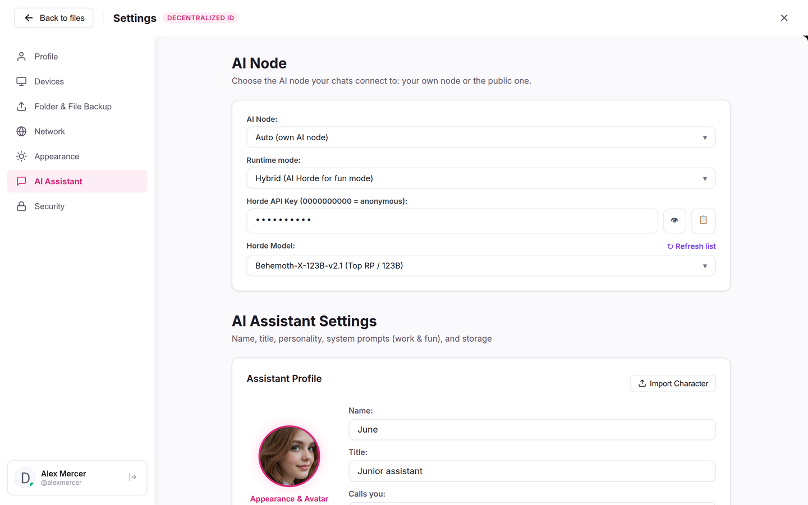
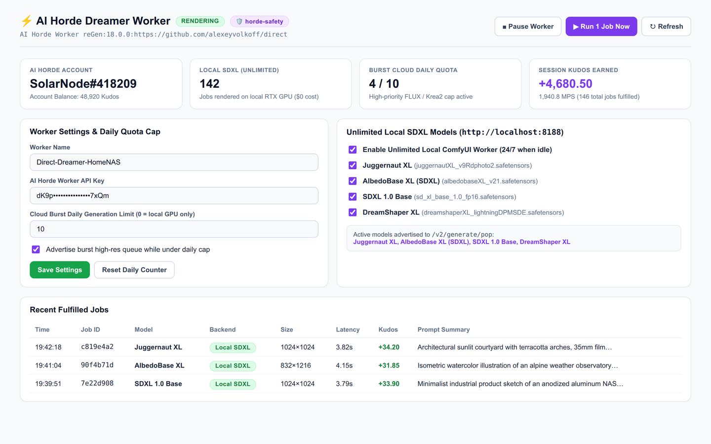

# AI Assistant Direct — Self-Hosted AI Node

[](LICENSE)
[](https://disk.direct)
[](https://aiassistant.direct/?launch=1)
[](https://ollama.com)
[](https://docs.disk.direct)
[](https://discord.gg/qAQpfmrBPW)

**AI Assistant Direct** (`ai/`) is the open-source, self-hosted AI node for the [**Direct**](https://github.com/alexeyvolkoff/direct) ecosystem ([**disk.direct**](https://disk.direct) & [**aiassistant.direct**](https://aiassistant.direct)), powered by **Ollama** (or **RKLLAMA**). It runs on **Linux**, **Windows**, **macOS**, home servers, NAS boxes, and ARM SBCs — giving you private RAG over your local folders, mobile/PWA remote access over peer-to-peer WebRTC without port forwarding, and a built-in Creative Studio with an AI prompt assistant.

---

## Highlights

- **Private Multilingual RAG & Photo Indexing** — Indexes local documents (`PDF`, `DOCX`, `XLSX`, `PPTX`, `MD`, code) and photos directly from your folders using ChromaDB and CPU-friendly `paraphrase-multilingual-MiniLM-L12-v2` embeddings. Bare photos are automatically captioned and OCR-indexed via Ollama vision models (e.g. `gemma4`) without uploading files to third-party clouds.
- **Mobile & PWA Remote Access (Zero Port Forwarding)** — Connect to your home Ollama node from any phone or browser at [**aiassistant.direct**](https://aiassistant.direct) or [**disk.direct**](https://disk.direct) over encrypted P2P WebRTC DataChannels. No static IP, router setup, or VPN required.
- **Passwordless Cryptographic Identity (DID)** — Access control is based on W3C-style Decentralized Identifiers (`DID` keypairs with portable `.json` keyfiles) and P2P device pairing (`LinkID` / QR) — **no static API tokens in `config.ini`**.
- **Creative Studio & Prompt Assistant** — Includes an Ollama-powered **AI Art Director** that writes and surgically refines visual prompts, plans multi-scene storyboards, manages character Personas, and drives local **ComfyUI** pipelines (SDXL DMD2, IP-Adapter Plus Face + ReActor FaceSwap, Auto-Inpaint retouch, Krea 2, Anima, video generation, and 1-click CivitAI publishing).
- **Flexible Runtime Modes (`local` · `agentic` · `hybrid` · `horde`)** — Run everything on a single GPU box (`local`), keep lightweight CPU indexing on an always-on NAS/SBC while tunneling Ollama & ComfyUI over P2P to a desktop GPU (`agentic`), tap into the crowdsourced [**AI Horde**](https://aihorde.net) cluster (`horde` / `hybrid`), or run on Rockchip RK3588/RK3576 NPUs via `RKLLAMA`.
- **Built-in AI Horde Client & ComfyUI Dreamer Worker (`/horde`)** — Includes both an **AI Horde text & image generation client** (`horde_client.py`, `horde_dreamer.py`) and an idle-aware **AI Horde Image Worker ("Dreamer")** with a live management console at `http://localhost:4000/horde` that contributes idle ComfyUI GPU cycles (`SDXL` / `Krea 2`) to the Horde and earns Kudos automatically.
- **MCP Tools, Voice & Push Notifications** — Native Model Context Protocol (`MCP`) server & client integrations, WordCraft / GridCraft / DeckCraft document tools, local neural TTS (`Kokoro-82M`), and Web/mobile push notifications when background tasks or renders complete.

---



---

## Architecture

```text
┌───────────────────────────┐         Signaling & DID Handshake         ┌───────────────────────────┐
│   Browser / Mobile Apps   │ <───────────────────────────────────────> │        disk.direct        │
│    aiassistant.direct     │                                           │     aiassistant.direct    │
└─────────────┬─────────────┘                                           └─────────────▲─────────────┘
              │                                                                       │
              │            Direct Encrypted P2P Tunnel (WebRTC DataChannel)           │
              └───────────────────────────────────┬───────────────────────────────────┘
                                                  │  (No port forwarding / No cloud storage)
                                                  ▼
                                    ┌───────────────────────────┐
                                    │     Disk Direct Node      │
                                    │   (Local P2P File Node)   │
                                    └─────────────┬─────────────┘
                                                  │ 127.0.0.1:4000
                                                  ▼
                                    ┌───────────────────────────┐
                                    │  AI Assistant Node (ai/)  │
                                    ├───────────────────────────┤
                                    │ • Ollama (LLM & Vision)   │
                                    │ • ChromaDB (Local RAG)    │
                                    │ • ComfyUI (Studio Render) │
                                    │ • Kokoro TTS & MCP Tools  │
                                    └───────────────────────────┘
```

1. **Disk Direct Storage Node** ([`core/`](../core)) shares selected local folders over P2P WebRTC and routes authenticated AI requests to the local AI service on `127.0.0.1:4000` along with the caller's verified `DID` and pairing role (`owner` / `guest`).
2. **AI Assistant Direct Node** (`ai/`) orchestrates chat streaming, background RAG indexing, semantic search, MCP tools, and ComfyUI workflows against your local **Ollama** instance (`http://localhost:11434`) or a P2P-tunneled GPU node.

---

## Quick Start

### 1. Prerequisites

- **OS (All Major Platforms Supported):**
  - **Linux:** Ubuntu, Debian, Armbian, NAS & SBCs (`x86_64` and `arm64`)
  - **Windows:** Windows 10 / 11 (`x64` — per-user install, no Administrator rights needed)
  - **macOS:** Apple Silicon M1–M4 (`arm64` — per-user install, no `sudo` needed)
  - **Clients & Edge:** Any modern browser / PWA, native Android & iOS apps (**Disk Direct**), plus storage/tunnel nodes on OpenWrt routers
- **Python:** 3.10+ *(configured automatically by the one-command installers)*
- **Ollama:** Installed locally for GPU/Metal/CPU inference (`--gpu` / `-Gpu`), or optional in **Agentic P2P** mode (`--agentic` / `-Agentic`) where inference runs over P2P on a remote GPU
- **Disk Direct Node:** Local P2P WebRTC daemon — installed together with the AI node in one step via the [**⚡ TL;DR Quick Install Guide**](https://docs.disk.direct/advanced/#-tldr--quick-install-recommended-agentic-ai-setup)

### 2. One-Command Cross-Platform Install (Recommended)

Follow the [**⚡ TL;DR — Quick Install**](https://docs.disk.direct/advanced/#-tldr--quick-install-recommended-agentic-ai-setup) in the official documentation to deploy both the **Disk Direct Node** and **AI Assistant Direct** in a single command on **Linux**, **Windows (`PowerShell`)**, or **macOS (`Terminal`)** — either in lightweight **Agentic P2P** mode (`--agentic` / `-Agentic`) or full local **Ollama GPU** mode (`--gpu` / `-Gpu`).

### 3. Standalone Linux / Rockchip SBC Installer (`install.sh`)

If you already run the Disk Direct node daemon on Linux and want to install the AI service directly from this repository (with **Ollama** or Rockchip **RKLLAMA** NPU systemd units):

```bash
git clone https://github.com/alexeyvolkoff/direct.git
cd direct/ai
sudo ./install.sh ollama
```

Pull your preferred Ollama model (for chat + vision photo indexing, `gemma4` is recommended):

```bash
ollama pull gemma4:latest
```

To update an existing `/opt/onmychat` service installation later:

```bash
cd /opt/onmychat && sudo ./update.sh
```

### 4. Manual Installation (Cross-Platform Development)

```bash
git clone https://github.com/alexeyvolkoff/direct.git
cd direct/ai

python3 -m venv venv
source venv/bin/activate   # Windows PowerShell: .\venv\Scripts\Activate.ps1

# Optional on CPU-only / ARM machines to skip CUDA wheels:
# pip install torch torchvision --index-url https://download.pytorch.org/whl/cpu

pip install -r requirements.txt
cp config.example.ini config.ini

uvicorn api:app --host 127.0.0.1 --port 4000
```

---

## Configuration (`config.ini`)

No API tokens or shared secrets are needed in `config.ini` — trust and ownership are handled automatically via local Disk Direct node pairing and cryptographic `DID` signatures.

Key settings in [`config.example.ini`](config.example.ini):

```ini
[settings]
GATEWAY_URL = https://disk.direct

# Inference mode: local | agentic | hybrid
# AI_PROVIDER = local

# Local Ollama endpoint & models
OLLAMA_URL = http://localhost:11434
DEFAULT_MODEL = gemma4:latest
WORK_MODEL = gemma4:latest
FUN_MODEL = gemma4:latest
VISION_MODEL = gemma4:latest
LLM_NUM_CTX = 32768

# Optional: Local ComfyUI for Creative Studio
COMFY_API_URL = http://localhost:8188
WORKFLOW_PATH = flow.json
COMFY_OUTPUT_DIR = /opt/ComfyUI/output
COMFY_INPUT_DIR = /opt/ComfyUI/input

# Optional: Auto-caption & OCR photos during /rag/index via VISION_MODEL
# AUTO_RECOGNIZE_IMAGES = true

# Optional: Neural Voice (Kokoro-82M)
# TTS_ENABLED = true
```

### Agentic Split Mode (`AI_PROVIDER = agentic`)

If you run the AI node on a low-power always-on NAS or mini-PC without a discrete GPU, set `AI_PROVIDER = agentic` (or switch to **Agentic** directly in the web UI under **Settings → AI Assistant**). Knowledge indexing and ChromaDB stay local on CPU, while Ollama and ComfyUI calls are transparently tunneled over Disk Direct P2P to a paired desktop GPU node (`agentic_tunnel.py`).

### AI Horde Client & Built-in ComfyUI Dreamer Worker (`/horde`)

**AI Assistant Direct** integrates natively with [**AI Horde**](https://aihorde.net) both as a **Client** (`horde_client.py`, `horde_dreamer.py`) and as an **Idle-Aware ComfyUI Image Worker ("Dreamer")**:

- **Dual Work & Fun (Roleplay) Modes (`AI_PROVIDER = hybrid` / `horde`):**
  - **Work Mode:** Serious private productivity — local multilingual RAG over your documents (`PDF`, `DOCX`, `XLSX`, `PPTX`, `MD`, code), semantic search, and MCP tools powered by your local Ollama model.
  - **Fun / RP Mode:** Switch seamlessly to crowdsourced **AI Horde** 70B–123B roleplay models (or local models) with **1-click SillyTavern Character Card (`.png` / `.json`) import**, custom Personas, appearance & avatar generation, and neural voice (`Kokoro-82M`).
- **Built-in Dreamer Worker (`HORDE_WORKER_ENABLED = true`):** Contribute your idle local ComfyUI GPU cycles (`hordelib`-compatible SDXL text-to-image pipeline honoring the requester's `steps`, `cfg_scale`, `sampler_name`, `karras`/`scheduler`, and `clip_skip`, plus optional daily-capped `Krea 2`) to AI Horde and earn Kudos automatically whenever your local ComfyUI queue is empty. Manage models, quotas, and live telemetry in the built-in web console at `http://localhost:4000/horde` (or via the **AI Horde** Node App inside **Disk Direct**).
- **Mandatory `horde-safety` (NSFW & CSAM) Scanning & Maintenance Compliance:** Every generated image is scanned via [`horde-safety`](https://github.com/Haidra-Org/horde-safety) (`NSFWChecker` with `CLIP ViT-L/14` + `DeepDanbooru`) before R2 upload and `/v2/generate/submit` (fail-closed if `horde_safety` is unavailable, replacing flagged CSAM/SFW-censored images with official AI Horde censor placeholders and reporting `state: "csam"` / `"censored"` and `gen_metadata`). If the worker is placed into **Maintenance Mode** on AI Horde, it automatically pauses polling and never auto-clears the maintenance flag.





```ini
HORDE_WORKER_ENABLED = true
HORDE_WORKER_API_KEY = your_aihorde_api_key
HORDE_WORKER_NAME = Direct-Dreamer
HORDE_WORKER_MODELS = Juggernaut XL
```

---

## Pairing & Remote Access

1. Install the **Disk Direct Node** + **AI Assistant Direct** via the [**⚡ TL;DR Quick Install**](https://docs.disk.direct/advanced/#-tldr--quick-install-recommended-agentic-ai-setup) (Linux, Windows, or macOS).
2. Open [**aiassistant.direct**](https://aiassistant.direct/?launch=1) (chat-first PWA) or [**disk.direct**](https://disk.direct) (workspace + file manager) and create or load your **DID** identity (save your `.json` keyfile for 1-click sign-in on other devices).
3. Pair your machine using its **LinkID**, QR code, or local Claim page (`http://localhost:8081` on Windows/macOS, `http://localhost/` on Linux). Because you paired the node with your cryptographic DID, the AI service automatically recognizes you as the **Node Owner** with full private RAG and Creative Studio access — zero manual token copying required.

Learn more about decentralized identity and keyfiles in the [DID Documentation](https://docs.disk.direct/did/).

---

## Documentation

- [⚡ TL;DR — Cross-Platform Quick Install (Linux, Windows, macOS)](https://docs.disk.direct/advanced/#-tldr--quick-install-recommended-agentic-ai-setup)
- [Personal AI Node Guide](https://docs.disk.direct/ainode/)
- [Disk Direct & AI Assistant Direct Documentation](https://docs.disk.direct)
- [Decentralized Identity (DID) Guide](https://docs.disk.direct/did/)
- [Personal AI Node Setup Guide (EN)](docs/AI_NODE_SETUP_EN.md) · [RU](docs/AI_NODE_SETUP_RU.md) · [UA](docs/AI_NODE_SETUP_UA.md) · [SI](docs/AI_NODE_SETUP_SI.md)
- [Rockchip NPU (RKLLAMA) Setup Guide (EN)](docs/RKLLAMA_SETUP.md) · [RU](docs/RKLLAMA_SETUP_RU.md)
- [Google Colab Remote GPU Node Notebook](onmydisk_colab_ai_node.ipynb)

---

## License

Licensed under the [Apache License 2.0](LICENSE).
